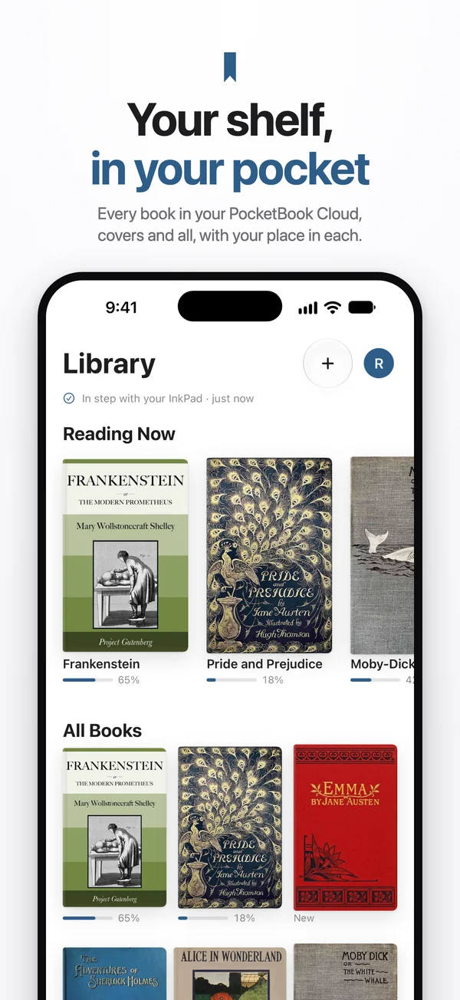
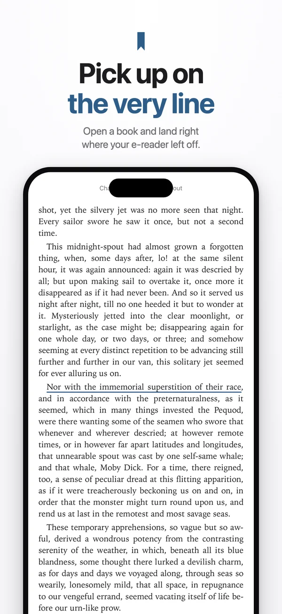
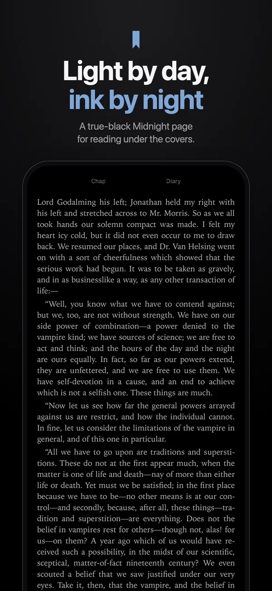

<!-- ourostack:brand:start -->

  

<!-- ourostack:brand:end -->

# Gatefold

**Pick up on the very same line.** Gatefold is a free reader for iPhone and iPad that keeps your place in step with your PocketBook e-reader, and it is built for every posture of iPhone Duo.

  
  
  

[Website](https://ourostack.github.io/gatefold/) · [Privacy](https://ourostack.github.io/gatefold/privacy/) · [Support](https://ourostack.github.io/gatefold/support/) · [More from Ouro](https://github.com/ourostack)

- **Your place, down to the line.** Reading position syncs both ways with your PocketBook e-reader.
- **Your marks come along.** Highlights, notes and bookmarks travel between the e-reader and your phone.
- **A real gatefold.** On iPhone Duo it reads folded, flat as a two-page spread, or half-open on the table.
- **Free, for good.** No ads, no subscriptions, no tracking.

**Get it:** Gatefold is in TestFlight testing and not on the App Store yet. To run it today, build it from source: `xcodegen generate`, then open `Gatefold.xcodeproj` in Xcode.

Not affiliated with or endorsed by PocketBook International SA.
